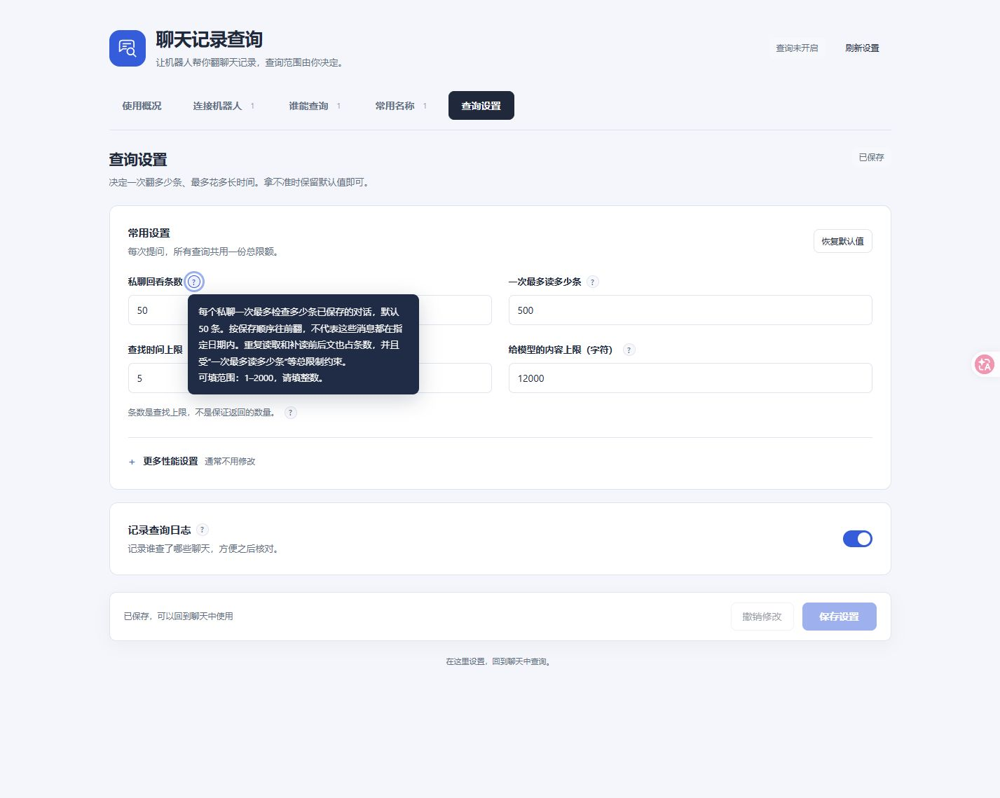

# 授权历史查询


**让 AstrBot 在聊天中，帮你查找允许访问的群消息和私聊旧对话。**

私聊机器人，直接问“英语群昨天布置了什么作业？”或“之前我们聊到的安排是什么？”。模型按需调用查询工具，读取相关片段后，沿用当前聊天的人格回答。你可以在 Web UI 中设置谁能查、能查哪些聊天，以及一次回看多少条。

[功能与示例](#features) · [Web UI](#webui) · [安装配置](#quick-start) · [权限设置](#permissions) · [记录与时间](#history) · [查询设置](#limits) · [常见问题](#faq)

> [!IMPORTANT]
> 当前查询接入仅支持已核验的 **AstrBot 4.29.4 + 内置 Agent + OneBot v11 / NapCat + SQLite**。私聊查询默认回看最近保存的记录，**不提供可靠的逐条发送时间，也不承诺按“昨天”精确筛选**。

<a id="features"></a>

## 功能与使用示例

| 你可以这样问 | 插件能做什么 |
| --- | --- |
| “帮我查一下英语群昨天布置了什么作业。” | 按群名或常用名称定位，在允许的范围内搜索关键词、时间和发送者 |
| “学院群和英语群最近有没有改活动时间？” | 分批查询多个聊天，保留每条结果的来源 |
| “这条通知后面有没有补充或取消？” | 按需补读命中消息前后的有限记录 |
| “之前我们聊到的那个安排是什么？” | 查找当前私聊下仍保存的 AI 旧对话，包括切换对话前的历史 |
| “有哪些人和你私聊过？先列出我能查询的对象。” | 分页列出允许查询、且存在已保存 AI 对话的私聊对象 |
| “看看小王最近和你聊了什么。” | 在已允许访问该私聊、且名称能够确定对象时，回看最近保存的对话 |

不需要专用查询命令，也不需要为每条消息额外调用一个判断模型。是否使用工具由当前聊天模型决定；查询范围由插件代码检查。

群名重名时会返回候选，请明确选择。没查完时先返回部分结果，你可以回复“继续”沿原范围往前读。查到的内容可以继续追问原文、来源和前后文。

<a id="webui"></a>

## Web UI

在 AstrBot 插件页打开 **授权历史查询 → 视图 → 聊天记录查询**；侧栏显示该入口时，也可直接点击 **聊天记录查询**。



*图中为本地合成配置，不含真实聊天记录或账号。*

| 页面 | 用来做什么 |
| --- | --- |
| 使用概况 | 开关查询功能，查看已配置的数量和查询状态 |
| 连接机器人 | 选择 AstrBot 中已有的连接，核对机器人 QQ 号 |
| 谁能查询 | 添加可以提问的人，为每个人选择可查的群和私聊 |
| 常用名称 | 给群聊或私聊起个熟悉的称呼，例如“英语群”“小王” |
| 查询设置 | 调整私聊回看条数、总读取量、耗时和查询日志 |

复杂选项旁的 **?** 支持鼠标悬停、键盘聚焦和手机点击查看说明。较少使用的参数收在“更多性能设置”中。

所有修改都在点击 **保存设置** 后生效。这里与 AstrBot 原来的“插件配置”页共用一份配置，建议一次只在一处编辑；发生保存冲突时，页面会保留未保存的修改并提示你处理。

页面仅管理设置，不浏览聊天正文。它使用 AstrBot 的登录和内嵌视图，不另开端口，无需安装前端服务。运行状态按加载或刷新时更新，没有后台轮询。

<a id="quick-start"></a>

## 安装与首次配置

### 1. 确认运行条件

| 项目 | 当前要求 |
| --- | --- |
| AstrBot | 4.29.4，使用内置 Agent |
| QQ 接入 | OneBot v11 / `aiocqhttp`，面向 NapCat |
| 聊天模型 | 支持工具调用（Function Calling / Tools） |
| 历史存储 | AstrBot 自身的 SQLite 数据库 |
| Python | 3.12 或更高版本 |
| 额外依赖 | 无额外运行依赖，不需要编译器、向量数据库或嵌入模型 |

查询群消息前，请确认 AstrBot 已开启并实际保存目标群的消息流水。安装本插件不会自动开启记录功能，也不会补录过去的消息。

### 2. 安装插件

在 AstrBot WebUI 的插件管理页，通过仓库地址安装：

```text
https://github.com/WinterMoonlight/astrbot_plugin_history_query
```

也可以下载源码，在源码根目录打包，再把生成的 ZIP 上传到 AstrBot 的插件管理页：

```shell
python tools/package.py
```

生成文件：`dist/astrbot_plugin_history_query-0.3.2.zip`。

### 3. 先配置一个机器人、一个人、一个群

下面用占位值举例：机器人连接为 `qq-main`，机器人 QQ 为 `100000`，你的 QQ 为 `200000`，要查的群号为 `300000`。请换成自己的值。

1. 打开 **连接机器人**，添加 AstrBot 中已有的连接 `qq-main`。点击“自动识别”核对机器人 QQ `100000`，然后保存。
2. 打开 **谁能查询**，添加你的 QQ `200000`。“他向哪个机器人提问”选择 `qq-main`。
3. 在这个人的 **可以查哪些群** 中选择机器人，输入群号 `300000` 后点击“添加”。也可以先点击“获取群列表”，再从群号输入框的候选中选择。保存设置。
4. 可选：在 **常用名称** 中给这个群添加“英语群”。如果原群名已经能准确定位，就不用另起名称。
5. 回到 **使用概况**，打开“开启聊天记录查询”并保存。用 QQ `200000` 私聊机器人：“帮我看看英语群最近有什么通知。”

**AstrBot 中的连接名称、机器人 QQ、提问者 QQ 是三个不同的值。** 连接名称对应 AstrBot 机器人配置中的 ID；`aiocqhttp` 是接入类型，不能替代这个 ID。

<a id="permissions"></a>

## 谁能查、能查什么

在 **谁能查询** 中，先选择一个人，再为他设置范围。添加了一个人的 QQ，并不代表他自动能查所有聊天。

| 设置 | 含义 |
| --- | --- |
| 他向哪个机器人提问 | 这个人必须私聊选中的机器人，才能使用这份查询权限 |
| 可以查哪些群 | 只允许查询添加到这里的群 |
| 可以查谁的私聊 | 填写对方 QQ，允许查询对方与机器人的已保存 AI 对话 |
| 全部群聊 / 全部私聊 | 开放所选机器人上的全部对应聊天，之后新增的也包含在内 |

例如，允许 QQ `200000` 查询 QQ `400000` 与机器人的对话：选择 `200000`，在“可以查谁的私聊”中添加 `400000`。这不会开放 `400000` 与其他人的 QQ 聊天。

每个人的范围独立配置，群与私聊分别设置。不在名单中的人仍可正常和机器人聊天，但不能使用本插件查询其他聊天。不需要为了查询而给予完整的 AstrBot 管理员权限；聊天查询权限也不等于 Web UI 管理权限。

插件使用事件中的真实连接 ID、机器人账号、发送者 QQ 和当前聊天核对身份。昵称、常用名称，或一句“我是管理员”，都不能代替权限检查。每次查询和补读都会重新检查权限。

机器人已退群，或者本次无法确认它仍在群里时，不开放该群的历史。更换机器人 QQ 时，建议在 AstrBot 中新建连接，不要让同一个连接 ID 继续混用旧账号的历史。

<details>
<summary>使用原插件配置页或 JSON 配置</summary>

普通使用建议通过独立 Web UI 添加。手动配置时，来源采用以下格式：

| 字段 | 示例 |
| --- | --- |
| `groups`：指定群 | `qq-main:GroupMessage:300000` |
| `private_sessions`：指定私聊 | `qq-main:FriendMessage:400000` |
| `all_groups_on`：某机器人上的全部群 | `qq-main` |
| `all_private_on`：某机器人上的全部私聊 | `qq-main` |

这些字段属于某一名 `readers` 用户；引用的连接必须先在 `instances` 中配置。空列表不会自动开放全部范围。

参见 [完整配置示例](examples/config.json)。通过原插件配置页修改后，请按 AstrBot 的提示重载插件。

</details>

<a id="history"></a>

## 能查到哪些记录

插件直接以只读方式查询 AstrBot 已有的 SQLite 数据。群消息流水与私聊 AI 对话是两种不同的数据来源。

| 来源 | 查询内容 | 时间依据 |
| --- | --- | --- |
| 群消息流水 | AstrBot 收到、保存且尚未清理的群消息 | 使用保存时间筛选，不保证等于 QQ 原始发送时间 |
| 私聊 AI 对话 | 同一个私聊下仍保存的多个 AI 对话 | 整段对话有创建、更新时间；当前读取器不提供可靠的逐条发送时间 |
| 图片、语音和附件 | 已保存的文字描述或占位信息 | 不额外下载、识别媒体内容，也不读取附件路径指向的文件 |

AI 对话历史不保证包含发送给机器人的每一条原始消息。插件不读取个人 QQ 客户端数据库，也无法恢复机器人没收到、没保存或已经删除的内容。

“没有找到”只表示在本次可查询范围内没有命中，不能证明某件事从未发生。

<a id="private-time"></a>

### 为什么私聊默认“往前翻”，而不是按日期筛选？

一段 AI 对话可能持续好几天。它今天更新过，不代表里面每条消息都在今天发送；正文中出现“昨天”或某个时刻，也不能直接当作发送时间。

因此，私聊先选择最近更新的对话，再从该对话尾部往前读，**每个目标私聊每轮默认最多检查 50 条**，可在 Web UI 修改。即使你问“昨天”或“这段时间”，当前策略也是先有限回看，并说明未按日期筛选，不再要求你先确认取消日期。

这个顺序近似“最近保存”，不是逐条消息的严格时间排序。私聊对象列表同样只说明存在已保存的 AI 对话，不能当作某个时段的完整来信名单；每页最多 5 个，按会话标识分页，不按活跃度排名，也不会自动读取所有人的正文。

### 群聊默认查多久？

没有指定时间时，先看最近 24 小时的消息频率：达到 **300 条**按高频处理，默认查 24 小时；低于该阈值默认查 3 天。样本不足时，保守查 24 小时并说明情况。

这是查询窗口，不是保存期限。AstrBot 按条数保留消息时，实际能覆盖几天取决于群的消息量。

<a id="limits"></a>

## 查询设置与继续查询

这里的“一轮”指：你发出一条消息后，机器人为回答它进行的全部查询。多个工具调用、多个聊天共享总限制，重复读取和补读前后文也会计数。

在 **查询设置** 中可以直接修改：

| 设置 | 默认值 | 含义 |
| --- | --- | --- |
| 私聊回看条数 | 50 条 | 每个私聊每轮的检查上限，可填 1–2000 的整数 |
| 一次最多读多少条 | 500 条 | 本轮所有来源的总读取上限，也包含群消息频率采样 |
| 查找时间上限 | 5 秒 | 读取与筛选的累计时间，不含排队和模型生成回答 |
| 给模型的内容上限 | 12,000 字符 | 所有查询结果的文字总量，过长会截短并标记 |
| 记录查询日志 | 开启 | 记录查询者、来源、状态和数量，不记录聊天正文 |

**这些是上限，不是保证返回的数量。** 例如私聊回看设为 50，而总读取上限设为 30，本轮也只能在总额度内读取。剩余额度不是剩余历史条数，不能据此说“还有四百多条消息没查”。

<details>
<summary>更多性能设置及固定限制</summary>

| 设置 | 默认值 |
| --- | --- |
| 每批读取条数 | 25，多个聊天轮流分批读取 |
| 最多排队多久 | 累计 5 秒，与查找时间分开计算 |
| 最多排队几个请求 | 4 个，不含正在执行的查询 |
| 单份记录大小上限 | 1 MiB；过大时跳过或拒绝读取并说明 |
| 闲置多久释放内存 | 30 秒，之后关闭查询工作进程 |

当前固定同时执行 1 个历史查询；一次最多选择 5 个来源。搜索请求默认最多返回 20 条，最多可请求 50 条，仍受总字符数限制。

用于补读、分页和续查的引用默认有效 15 分钟，最多保留 2048 项。重载、重新保存设置或历史发生变化时，旧引用可能失效，需要重新查询。

超时会停止继续读取；必要的取消、回收可能另有少量耗时。500 条是逻辑读取额度，不代表 SQLite 内部最多扫描 500 行。

</details>

达到限制时，先回答已查到的部分并说明没查完；下一轮回复“继续”，沿原来的范围和位置往前读，不必重复确认同一组目标，但插件仍会核对当前权限。

续查使用稳定游标，减少新增、删除消息引起的页码错位；它不是永久快照。历史被清理、对话内容改变或引用过期时，可能需要从头查询。

<a id="faq"></a>

## 常见问题

<details>
<summary>安装后还是不能查，先检查什么？</summary>

确认查询开关已开启、机器人连接与 QQ 相符、提问者和目标聊天已添加；再检查是否为 AstrBot 4.29.4、内置 Agent，以及当前模型是否支持工具调用。

如果 AstrBot 将本插件的三个工具另外设为了“管理员专用”，也需要检查宿主的工具权限。插件名单不会绕过这些限制。

其他 AstrBot 版本或内部接入检查失败时，插件只停用历史查询，不影响普通聊天。不要把修改版本号当作完成兼容适配。

</details>

<details>
<summary>换一个 QQ 提问，为什么回答“翻不到”，而不是“没有权限”？</summary>

当前版本会先检查身份；对于没有查询权限的 QQ，通常直接从该次请求中隐藏历史查询工具，没有额外向模型解释具体原因。模型可能因此回答“看不到”“翻不到”，而不是明确说没有权限。

这种回答不代表已经搜索数据库、结果为空。若 QQ 已获准查询，也仍需检查目标聊天是否在他的允许范围内。当前尚未实现专门向模型传递“这个账号未开通查询”的提示。

本插件不会因为缺少查询权限而禁止普通聊天；如果连日常问答也被拒绝，需要结合具体回复检查其他设置。

</details>

<details>
<summary>数据库里明明有消息，为什么没找到，或者只返回几条？</summary>

检查目标名称、允许查询的范围、机器人是否仍在群内，以及本次关键词和时间条件。然后看是否已经用完条数、时间或字符上限。

私聊查的是 AI 对话，默认只有限回看最近保存的内容；群消息也可能已经被 AstrBot 清理。可以缩小关键词或在提示未查完后继续往前读。

</details>

<details>
<summary>为什么有时显示昵称，有时仍然只有 QQ 号？</summary>

私聊优先使用已配置或已保存的名称，缺失时限时查询当前 QQ 昵称；查询失败或超时才退回 QQ 号。当前昵称可能与发送消息时不同，名称也不用于认定身份或授予权限。

</details>

<details>
<summary>查历史后，为什么天气、提醒等其他工具没继续执行？</summary>

从开始读取历史到本轮回答结束，只允许继续历史查询和上下文补读；新的发送、提醒等操作请在下一条消息明确提出。此前已经启动的工作可以完成，尚未读取历史的普通轮次照常使用原有工具。

限制只覆盖当前轮次经过受控执行入口新启动的工具，不是整个 AstrBot 的沙箱，不拦截其他插件独立的定时任务或内部调用。

</details>

<details>
<summary>查到的记录会进入当前上下文吗？能用 /new 和 /reset 控制吗？</summary>

命中片段作为工具结果交给当前聊天模型，所以可以继续追问。AstrBot 的正常保存流程可能保留工具结果和回答，但不会把所有来源历史整体合并到当前私聊。

使用默认命令前缀时，`/new` 保留旧对话并切换到新对话，`/reset` 清空当前对话上下文。它们不撤销查询权限，也不删除其他来源的原始记录。`/new` 保留的旧对话，在允许的范围内仍可能被再次查询。

</details>

<details>
<summary>会产生缓存文件吗？会不会一直占空间？</summary>

昵称和续查引用主要保存在内存中，并有有效期与数量上限。昵称成功缓存约 5 分钟、失败约 30 秒，最多 256 项；到期后不再复用，按访问或容量淘汰，不是定时立即删除。引用按访问和新增清理，重载后清空。

查询日志位于 `data/plugin_data/astrbot_plugin_history_query/`，保留 `query-audit.jsonl` 与 `query-audit.previous.jsonl` 两份，每份约 1 MiB；写满轮换。关闭日志不会删除已有文件。Python 的 `__pycache__` 是编译缓存，不是聊天正文缓存。

这些清理不会删除 AstrBot 自己的聊天历史、已保存的工具结果或人工部署备份；部署备份也不由本插件自动清理。

</details>

<a id="privacy"></a>

## 数据与隐私

- **只读历史**：不修改 AstrBot 历史表、结构或索引，不另外建立完整聊天正文副本；不读取个人 QQ 客户端数据库。
- **模型会看到命中片段**：片段参与当前模型的回答流程，使用 AstrBot 配置的模型服务。检索在本地执行，不等于内容一定只在本地处理；正常工具调用和回答仍会产生模型用量。
- **日志不存正文**：仅保存查询时间、查询者、来源标识、状态和数量，不保存关键词或完整问题。
- **不会主动执行聊天里的指令**：历史作为待分析资料，不能扩展权限。插件本身不修改消息、不创建提醒，也不主动向其他群或用户发送消息。
- **已有副本不会自动消失**：删除原始记录或撤销权限，不会自动清除先前已进入 AstrBot 对话的工具结果和回答。

<a id="development"></a>

## 开发、验证与反馈

v0.3.2 的本地与服务器验证各通过 101 项 Python 合成测试；前端断言和 AstrBot 4.29.4 原始工具类契约检查通过。已在部署环境核对插件加载、管理视图、登录保护与配置保留；没有用真实聊天记录测试外部模型。自然语言回答是否准确仍需核对来源，测试不代表所有模型和插件组合都已覆盖。

[实施方案](docs/实施方案.md) · [模块与实现边界](docs/开发说明.md) · [验证范围](docs/验证状态.md) · [自动化结果](docs/validation.json) · [更新记录](CHANGELOG.md)

<details>
<summary>工具接口与本地开发命令</summary>

| LLM 工具 | 职责 |
| --- | --- |
| `history_query_find_sessions` | 定位允许查询的聊天，或分页列出已保存的私聊对象 |
| `history_query_search` | 按范围和条件读取历史，返回来源、覆盖情况和续查引用 |
| `history_query_read_context` | 根据命中记录的引用，补读同一范围的前后文 |

运行合成测试、前端检查与打包：

```shell
python -m unittest discover -s tests -t . -v
node tests/test_view_model.mjs
python tools/package.py
```

Node.js 只用于前端开发检查，安装运行插件不需要它。可选的上游契约检查需要 `requirements-dev.txt` 中的依赖，以及已核验的 AstrBot v4.29.4 源码：

```shell
python tests/check_upstream_contract.py --source PATH_TO_ASTRBOT_SOURCE
```

检查会核对源码哈希并使用原始工具类；部分宿主组件仍为合成替身，不能替代完整环境联调。

本地 Web UI 预览：

```shell
python tools/preview_view.py --port 8766
```

打开 `http://127.0.0.1:8766/`，加上 `?theme=dark` 可预览深色模式。预览仅使用内存中的合成配置，关闭进程后丢弃，不读取服务器数据。

[工作进程基准](docs/benchmark.json)来自本机合成测试，不包含 AstrBot、NapCat、模型或真实网络开销，也不是 2 核 2 GB 服务器的性能保证。更多限制见[验证范围](docs/验证状态.md)。

</details>

反馈问题请前往 [Issues](https://github.com/WinterMoonlight/astrbot_plugin_history_query/issues)，附上插件与 AstrBot 版本、复现步骤和经过脱敏的错误信息。不要上传完整聊天数据库、模型密钥、SSH 凭据或私人消息。

文档组织参考了 [群聊日常分析插件](https://github.com/SXP-Simon/astrbot_plugin_qq_group_daily_analysis)的功能展示、配置说明与常见问题结构。
